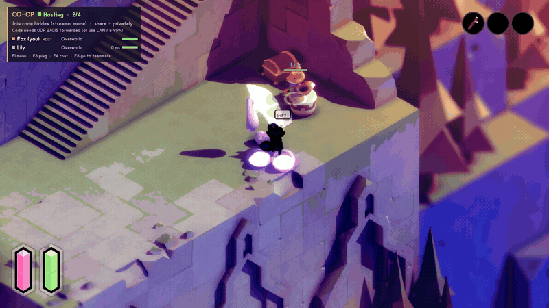
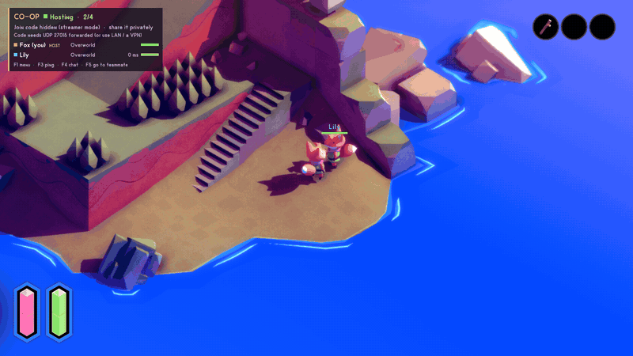

# TUNIC Seamless Co-op

Play TUNIC together: 2–8 players in one shared world. Everyone sees each other move and fight, enemies and
bosses are shared, progress and items belong to the whole party, and a fallen fox can be revived by a friend.




> Unofficial fan mod. Not affiliated with Andrew Shouldice, Finji or the TUNIC team. Every player needs their
> own copy of TUNIC.

## Features

- **Seamless co-op** for 2–8 players, on Steam, Epic or GOG copies (mix and match).
- **Shared world.** Doors, chests, bells and items are shared. Money and consumables are either shared or each
  player's own (host's choice).
- **Shared enemies and bosses.** Bosses, their adds and the Cathedral gauntlet are fought together and stay in
  sync.
- **Down, not out.** Instead of dying you go down and spectate your team until someone revives you.
- **Go to teammate.** F5 or the menu takes you to a friend, even in another area. You're told when someone
  walks into a boss arena.
- **Pings and quick chat.** F3 marks a spot for everyone (with an arrow at the screen edge when it's off
  screen). F4 picks a short phrase like "Help!" or "Over here!".
- **Optional shared camera** that keeps your group on screen.
- **Host rules.** Revive on or off, revive time and health, bleed-out timer, enemy toughness per extra
  player, and shared or personal money.
- **Join codes and automatic port forwarding (UPnP)**, plus **Steam "Join Game"** for Steam copies.
- **Streamer mode** hides every address and join code on screen.
- **One-click installer** that also installs BepInEx for you.

## What is synced

| | |
|---|---|
| Players | Position, facing, animations (rolls, attacks, items), equipment and effects, smooth 100 ms playback |
| Areas | Players in different areas don't see each other; walk through a door, or press F5, to meet up again |
| World | Doors, bells, switches and other progress flags; opened chests; defeated bosses |
| Inventory | Items and upgrades are shared. Money, consumables and potions are shared by default; the host can make them personal |
| Coins | Coins that drop (pots, chests, enemies) appear for everyone and can only be collected once |
| Pots & grass | Breaking a pot breaks it for everyone (coins inside are not duplicated) |
| Enemies | Each enemy is run by the nearest player and mirrored for everyone else; anyone can hit any enemy |
| Bosses | One player runs the boss for the whole fight (no mid-fight handover); everyone sees its health bar, attacks and death; hits from every player count |
| Ambushes & waves | Enemies that appear mid-area (boss adds, Cathedral gauntlet waves, ambushes) appear for everyone, wherever they were triggered |
| Death | With a teammate still standing you go **down** instead (see *Down, not out*). If everyone is down, or nobody else is in the session, you die and respawn at your campfire as usual |

## Install

**Easy way:** download `TunicCoop-<version>.zip` from
[Releases](https://github.com/AfroPK/tunic-seamless-coop/releases), extract it anywhere and double-click
**Install.bat**. It finds TUNIC (Steam, Epic or GOG, or asks for the folder) and installs
[BepInEx 6.0.0-pre.1](https://github.com/BepInEx/BepInEx/releases/tag/v6.0.0-pre.1) if needed. It downloads the
official release and checks its SHA-256 before using it. Then it copies the mod in. Start TUNIC: the very first
start with BepInEx takes a minute or two.

**By hand:**

1. Find your TUNIC folder (the one with `Tunic.exe`):

   | Store | Usually |
   |---|---|
   | Steam | `…\steamapps\common\TUNIC` (Steam → right-click TUNIC → Manage → Browse local files) |
   | Epic | `C:\Program Files\Epic Games\TUNIC` |
   | GOG Galaxy | `C:\Program Files (x86)\GOG Galaxy\Games\TUNIC` |
   | Xbox / Game Pass | Only if the folder is accessible (Xbox app → Manage → Files → Browse) |

2. Extract [BepInEx_UnityIL2CPP_x64_6.0.0-pre.1.zip](https://github.com/BepInEx/BepInEx/releases/download/v6.0.0-pre.1/BepInEx_UnityIL2CPP_x64_6.0.0-pre.1.zip)
   next to `Tunic.exe` (the same version the TUNIC Randomizer uses).
3. Copy `BepInEx/plugins/TunicCoop` from this mod's zip into the TUNIC folder.
4. Start the game. A small **CO-OP · Offline** panel appears in the top-left corner.

Everyone in a session needs the **same mod version** (the mod refuses mismatches) and should have the **same
TUNIC version** (you get a warning if not). The mod checks GitHub once per launch and tells you when an update
is out.

**Use a dedicated co-op save.** When you join, your save takes on the host's world and inventory.

## Play

| Key | |
|---|---|
| **F1** | Co-op menu |
| **F3** | Ping the spot in front of you |
| **F4**, then **1–6** | Quick chat: Over here! · Help! · Wait for me · Let's go! · Thanks! · Careful! |
| **F5** | Go to a teammate: whoever just entered a boss arena, otherwise cycles through teammates |
| **F7 / F8 / F9** | Host · join the saved address or code · leave |
| While downed: **Left / Right**, hold **F2** | Switch who you spectate · give up and respawn |

The **F1 menu** has four tabs (**Tab** / **PgUp** / **PgDn** to switch, **Up/Down** to pick, **Left/Right**
to change, **Enter** to confirm):

- **Session**: your name (what others see; change it any time), join address or code, port, max players,
  Host / Join / Leave. The host's join code is shown here and in the co-op panel.
- **Rules**: the session's rules (the host edits, everyone else sees them, see *Host rules*).
- **Players**: "Go to …" for each teammate, ping, quick chat.
- **Options**: streamer mode, shared camera, automatic port forwarding, Steam "Join Game", update check.

On screen you'll see the **co-op panel** (top-left: status, join code, every player's area, ping and
health), **nameplates** with health and quick-chat bubbles, **markers** for pings and downed teammates (at the
screen edge when off screen), a **chat log** (bottom-right) and **messages** (top-centre) that explain what
happened in plain words.

### Down, not out

When a hit would kill you and a teammate is still up, you're **downed** instead. Your fox stays where it fell
(red *DOWNED* nameplate, plus a marker for teammates) and your camera follows a teammate.

- A teammate revives you by **standing next to you** for 3 seconds (they see a *Reviving …* bar). You get back
  up with half your health.
- **Left / Right** switches who you watch. **Hold F2** to give up and respawn at your campfire.
- If the host set a **bleed-out** time, you die for real when it runs out (a countdown shows).
- If every player is down at the same time, everyone dies and respawns as usual.

### Host rules

Set by the host in **F1 → Rules**. They apply to everyone and change live.

| Rule | Default | |
|---|---|---|
| Revive teammates | On | Down-and-revive instead of instant death while a teammate is up |
| Revive time | 3 s | How long a teammate stands next to you |
| Health after revive | 50 % | |
| Bleed-out | Never | Downed players die for real after 15/30/60/120 s without help |
| Enemy toughness | Vanilla | Enemies and bosses take +25…200 % longer to kill per extra player |
| Money & consumables | Shared | *Each their own*: everyone keeps their own money, consumables and potions; items and upgrades stay shared |

### Bosses and big fights

The player who starts a boss fight runs the boss until it ends, so its phases and attacks stay coherent. Everyone
sees the same boss, health bar and attacks, and everyone's hits count. Adds and gauntlet waves are shared even
if only one player's game spawned them. When a teammate walks into a boss arena you get a message, and **F5**
takes you there.

### Connecting

- **Join codes.** The host's panel shows a code like `4T7JA-E1QJK`. Type it in *Join address or code*
  instead of an IP.
- **Over the internet.** With **automatic port forwarding** on (default), the host's router opens UDP 27015
  by itself if it supports UPnP. Then friends anywhere can join with the code. If the router doesn't support
  it, the panel says so: forward UDP 27015 by hand, or use a virtual LAN such as Tailscale, ZeroTier or Radmin
  VPN.
- **Same network.** Use the host's LAN address or LAN code.
- **Steam.** Friends can use **Join Game** on you in their Steam friends list. If their TUNIC isn't running,
  Steam starts it and the mod joins as soon as their save has loaded. If it's already running, they can type
  your code instead.
- Allow TUNIC through Windows Firewall when asked.

#### Optional: a matchmaking relay (no port forwarding at all)

If UPnP isn't available and you don't want to forward ports or use a VPN, anyone in your group can run the
small relay from `server/TunicCoopRelay`. Prebuilt binaries for Windows and Linux are attached to each release.
Run it on any machine reachable on UDP 27016, such as a cheap VPS or a free-tier cloud VM:

```
TunicCoopRelay 27016
```

(On Linux, run `chmod +x TunicCoopRelay` first, and allow UDP 27016 in the server's firewall.)

Every player then sets `Network.Introducer = your.relay.address:27016` in the config. The host registers their
join code with the relay. A friend who joins with the code connects directly when possible, and otherwise the
relay introduces both sides so their routers let them talk (NAT hole punching). The relay never carries game
traffic. It only passes each side's public address, so it needs almost no bandwidth.

### Config (`BepInEx/config/com.freddy.tuniccoop.cfg`)

Most settings are also in the F1 menu.

| Setting | Default | |
|---|---|---|
| `Player.Name` | `Fox` | Your name |
| `Player.SharedCamera` | `false` | Keep teammates in the same area on screen (zooms out as you spread) |
| `Network.JoinAddress` | `127.0.0.1` | Host address or join code for F8 |
| `Network.Port` | `27015` | UDP port |
| `Network.MaxPlayers` | `4` | 2–8, including the host |
| `Network.Password` | *(empty)* | Must match the host |
| `Network.AutoPortForward` | `true` | UPnP port forwarding while hosting |
| `Network.Introducer` | *(empty)* | Optional matchmaking relay `host:port` for NAT punch-through (see above) |
| `Network.DiscoverPublicAddress` | `true` | While hosting, ask a STUN server (stun.l.google.com) for your public address, to show an internet join code |
| `Network.SteamInvites` | `true` | Steam copies: "Join Game" for friends |
| `General.CheckForUpdates` | `true` | One request to GitHub per launch |
| `Privacy.StreamerMode` | `false` | Hide addresses and join codes on screen |
| `Gameplay.*` | see *Host rules* | Used when you host |
| `World.SyncWorldFlags` | `true` | Share world progress and inventory |
| `Debug.*` | `false` | Developer test tools; leave off |

## Troubleshooting

- **"Couldn't reach …"**: check the address or code and the port. Make sure the host pressed *Host a
  session*, the host's firewall allowed TUNIC, and the router forwards UDP 27015 (or you're on the same VPN).
- **"Code needs UDP 27015 forwarded"** in the host's panel: the router didn't accept automatic forwarding (UPnP
  off or unsupported). Forward the port by hand or use a VPN.
- **"The host refused the connection"**: the password differs, or you have a different mod version.
- **Game version warning**: update TUNIC so everyone has the same version.
- **Your game crashed mid-session?** Start it again and join: you get your seat back right away.
- **A feature was "turned off after errors"**: your game build differs from the tested one. Co-op keeps
  working without that part. Please report your game version and store.
- Logs: `BepInEx/LogOutput.log`. Please attach it to bug reports.

## Known limitations

- **The Heir** (final boss) hasn't been fight-tested yet (it needs an endgame save). It uses the same boss sync
  as the five bosses that were tested.
- A boss chases and targets the player who runs it. The others fight it alongside, but it won't switch targets
  to them.
- Story cutscenes play for the player who triggers them. Boss defeat sequences play for everyone in the arena.
- The manual's map pages don't show teammates (TUNIC's map has no live position marker); the co-op panel lists
  everyone's area instead.
- Steam "Join Game" works when the friend's game is closed; if it's open they type the code.
- Tested on the Steam build. Epic and GOG builds of the same version should behave the same (nothing
  store-specific is required), and anything that differs switches itself off instead of breaking co-op.
- Other players' tether-wand wind-up flourish is not shown (the attack itself is).
- Some of TUNIC's own ghost-fox NPCs depend on each player's save, so one player may see a ghost another
  doesn't.

## How it was tested

Every feature was verified on two real PCs (plus a third game instance for 3-player tests) by a test autopilot
built into the mod (`Debug.EnableAutopilot`). It loads saves, hosts and joins, drives the fox with a virtual
gamepad, warps into boss arenas with TUNIC's own dev warp, and checks results from state files, logs and
screenshots. The regression covers:

- combat, aggro, coins, chests, area changes and death with bloodstain recovery
- revive, host rules, enemy toughness, pings and chat, shared camera and go-to-teammate
- join codes, leaving and rejoining, rejoining after a crash, and three players
- the Cathedral gauntlet and five bosses: Guard Captain, Garden Knight, Siege Engine, Librarian and Boss
  Scavenger

See `tools/suite.ps1` and `tools/run-all.ps1`.

## Building from source

Requires the .NET SDK and a TUNIC install with BepInEx already run once (for the interop assemblies):

```
dotnet build src/TunicCoop -c Release -p:TunicDir="C:\path\to\TUNIC" -p:Deploy=true
```

`tools/package.ps1` builds the release zip.

## Credits and disclosure

- [BepInEx](https://github.com/BepInEx/BepInEx) (LGPL-2.1) and its IL2CPP interop / Harmony / MonoMod stack.
- [LiteNetLib](https://github.com/RevenantX/LiteNetLib) (MIT), bundled.
- Thanks to the TUNIC modding community (TUNIC Randomizer) for establishing the BepInEx route.
- **Built with AI:** this mod was developed and tested by Claude (Anthropic) working with the author.

No game files or decompiled game code are included. License: MIT (see `LICENSE`).
